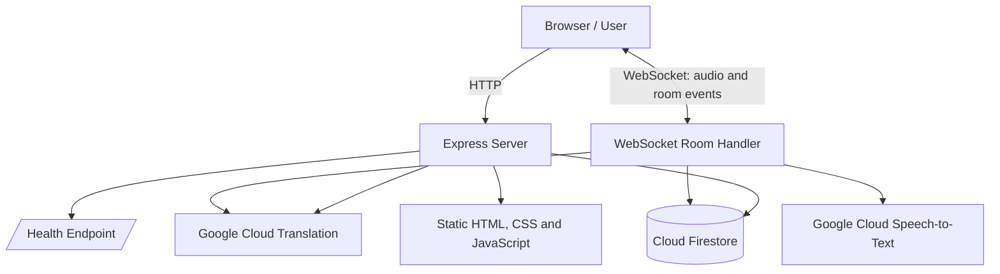

<div align="center">

# VoiceCast
### Real-time translation for conversations, text, and documents

**Understand more. Communicate without language barriers.**

A web-based translation experience built with Node.js, Express, WebSockets, and Google Cloud AI services. VoiceCast combines speech recognition, translation, shared conversation rooms, document workflows, and session analytics in one interface.

<p>
  
  
  
  
  
</p>

</div>

---

## Table of Contents

- [Overview](#overview)
- [Why VoiceCast?](#why-voicecast)
- [Features](#features)
- [How It Works](#how-it-works)
- [Technology Stack](#technology-stack)
- [Architecture](#architecture)
- [Supported Languages](#supported-languages)
- [Getting Started](#getting-started)
- [Google Cloud Configuration](#google-cloud-configuration)
- [Environment Configuration](#environment-configuration)
- [Run with Docker](#run-with-docker)
- [API Reference](#api-reference)
- [Project Structure](#project-structure)
- [Deployment](#deployment)
- [Security and Limitations](#security-and-limitations)
- [Roadmap](#roadmap)
- [Contributing](#contributing)
- [License](#license)

## Overview

VoiceCast is a browser-based translation application designed to make multilingual conversations easier. Users can translate text, work with supported documents, and join shared rooms where speech is transcribed and translated for participants who speak different languages.

The backend uses Google Cloud Speech-to-Text for streaming speech recognition, Google Cloud Translation for translations, and Cloud Firestore for conversation history and analytics. Express serves the web interface and REST endpoints, while WebSockets carry live room events between connected participants.

> **Project status:** The repository includes the application source and a Docker deployment setup. A deployment note is included in `UI-UPDATE.md`. Cloud credentials and live end-to-end integration are environment-specific; the included package has not itself been deployed or verified against live cloud services.

## Why VoiceCast?

Language barriers affect remote collaboration, travel, education, and everyday communication. VoiceCast brings several translation workflows into one application instead of treating text, documents, and live conversations as separate tools.

- **Live interaction:** WebSocket-powered rooms deliver participant and translated-message updates.
- **Cloud AI integration:** Speech recognition and translation are handled by Google Cloud APIs.
- **Conversation history:** Sessions can be stored and retrieved through Firestore.
- **Useful visibility:** Analytics endpoints aggregate session, message, language, and speech-confidence information.
- **Deployment-aware design:** A Dockerfile and health endpoint support container-based deployment.

## Features

### 1. Real-time multilingual rooms

- Create a conversation room and share its short room code.
- Join an existing room with a display name and language selection.
- Stream microphone audio for speech recognition.
- Receive interim transcription updates and translated final messages.
- See room members and microphone status updates.
- Retain a limited in-memory message history while the room is active.

### 2. Text translation

- Submit text with a source language and one or more target languages.
- Translate into multiple target languages through Google Cloud Translation.
- Return the original text, translations, and generated session ID.
- Attempt to save translation sessions to Firestore.

### 3. Document translation workflow

- Includes a document translation interface for supported file types.
- The document UI contains handling for common office and PDF document formats.
- Translation processing is designed around text extraction and segmented requests to accommodate larger documents.
- Exact file support and limits should be checked in the current UI and implementation before production use.

### 4. Session history and analytics

- Retrieve recent sessions and session details.
- Delete a stored session through the API.
- Aggregate message totals, target-language counts, session character counts, and available speech-confidence values.

### 5. User experience

- Responsive web interface with a light/dark theme on the landing experience.
- Searchable language selection and native-language labels.
- Motion controls and support for reduced-motion preferences in the landing experience.
- Health-check endpoint for deployment monitoring.

## How It Works

1. A user opens the web interface and chooses a translation workflow.
2. For a live room, the browser sends audio chunks to the server over a WebSocket connection.
3. The server streams audio to Google Cloud Speech-to-Text.
4. Recognized speech is translated into the languages needed by other room participants.
5. The server broadcasts translated messages and room-state events to connected clients.
6. Conversation data can be persisted in Firestore for later session retrieval and analytics.

For text translation, the browser submits text and language options to the REST API. The server calls Google Cloud Translation and returns the resulting translations.

## Technology Stack

| Layer | Technology | Purpose |
|---|---|---|
| Runtime | Node.js 18+ | Server-side JavaScript runtime |
| HTTP server | Express.js | Static assets and REST API |
| Real-time communication | `ws` (WebSockets) | Live room events and audio transport |
| Speech recognition | Google Cloud Speech-to-Text | Streaming speech transcription |
| Translation | Google Cloud Translation | Text and recognized-speech translation |
| Persistence | Google Cloud Firestore | Conversation history and analytics data |
| Messaging integration | Google Cloud Pub/Sub package | Included as a dependency; use depends on the active code path |
| Frontend | HTML, CSS, JavaScript | Browser interface and interactions |
| Visualization | Chart.js | Charts in the application interface |
| QR support | QRCode.js | QR-code interface support |
| Containerization | Docker | Reproducible container build and runtime |

## Architecture



**Design note:** This is a high-level view of the implemented integrations. Google Cloud credentials, IAM permissions, API quotas, and network configuration must be set up separately.

## Supported Languages

The shared language catalog currently defines **27 language options**, including:

English, Spanish, French, German, Italian, Portuguese, Dutch, Polish, Russian, Turkish, Arabic, Hindi, Marathi, Bengali, Tamil, Telugu, Gujarati, Kannada, Malayalam, Punjabi, Urdu, Japanese, Korean, Chinese, Indonesian, Vietnamese, and Thai.

Actual speech recognition support, language codes, and translation availability can differ by Google Cloud API and feature. Check the current Google Cloud documentation before relying on a language for a production use case.

## Getting Started

### Prerequisites

- Node.js 18 or later
- npm
- A Google Cloud project with billing enabled
- Google Cloud Speech-to-Text and Translation APIs enabled
- Firestore configured if you want session persistence and analytics
- Application Default Credentials or a service account with the required permissions

### 1. Clone the repository

```bash
git clone <YOUR_GITHUB_REPOSITORY_URL>
cd <YOUR_REPOSITORY_FOLDER>/translation-app
```

Replace the placeholders with your actual repository URL and folder name. If `package.json` is at the repository root, omit the `translation-app` directory from the command.

### 2. Install dependencies

```bash
npm install
```

### 3. Configure Google Cloud credentials

For local development, the recommended approach is Application Default Credentials:

```bash
gcloud auth application-default login
gcloud config set project YOUR_GOOGLE_CLOUD_PROJECT_ID
```

Enable the APIs required by the features you intend to run. For example:

```bash
gcloud services enable speech.googleapis.com
gcloud services enable translate.googleapis.com
gcloud services enable firestore.googleapis.com
```

Create/configure a Firestore database in the same Google Cloud project if you need saved sessions or analytics. Ensure the identity used by the application has only the permissions it needs.

### 4. Start the server

```bash
npm start
```

For development, the `dev` script uses Nodemon. Install it if it is not already available:

```bash
npm install --save-dev nodemon
npm run dev
```

### 5. Open the application

Visit:

- Landing page: `http://localhost:8080/`
- Application interface: `http://localhost:8080/app.html`
- Health check: `http://localhost:8080/health`

A healthy response should contain a JSON object with `status: "healthy"`. This verifies that the server responds; it does **not** prove that Google Cloud APIs, Firestore, microphone permissions, or translation workflows are fully working.

## Google Cloud Configuration

The backend creates Google Cloud clients using the standard client libraries. These clients use Application Default Credentials, so configure credentials before starting the application.

For a deployed service, prefer the platform's attached service identity (for example, a dedicated Cloud Run service account) rather than uploading a service-account key file. Grant least-privilege access to only the services the application needs.

**Never commit credentials, private keys, access tokens, or real user data to GitHub.** If a credential has been exposed, revoke or rotate it immediately.

## Environment Configuration

| Variable | Purpose | Default |
|---|---|---|
| `PORT` | HTTP server port | `8080` |
| Google Application Default Credentials | Authentication for Google Cloud clients | Configured by your local environment or deployment platform |
| Google Cloud project / Firestore setup | Cloud resource configuration | Set up in Google Cloud |

The current source does not define a comprehensive `.env` configuration layer. Do not assume that adding arbitrary environment variables will configure Google Cloud clients; follow the Google Cloud client library's supported credential and project configuration methods.

## Run with Docker

Build the image from the directory containing the `Dockerfile`:

```bash
docker build -t voicecast .
```

Run it locally:

```bash
docker run --rm -p 8080:8080 voicecast
```

The container exposes port `8080` and includes a health check that calls `/health`. For cloud-backed features, make sure the container receives credentials securely through your runtime environment. Do not bake service-account keys into the image.

## API Reference

Base URL for local development: `http://localhost:8080`

| Method | Endpoint | Purpose |
|---|---|---|
| `GET` | `/health` | Server health check |
| `POST` | `/api/translate-text` | Translate text into one or more target languages |
| `POST` | `/api/translate-document` | Document translation endpoint |
| `POST` | `/api/translate-batch` | Batch translation endpoint |
| `POST` | `/api/documents` | Document-related endpoint used by the application |
| `GET` | `/api/sessions` | List recent saved sessions (up to 50) |
| `GET` | `/api/session/:id` | Retrieve a session by ID |
| `DELETE` | `/api/session/:id` | Delete a saved session |
| `GET` | `/api/analytics` | Retrieve aggregated session and translation analytics; accepts an optional positive `limit` query parameter |

### Example: Text translation

**Request**

```http
POST /api/translate-text
Content-Type: application/json
```

```json
{
  "text": "Hello, how are you?",
  "sourceLanguage": "en-US",
  "targetLanguages": ["hi", "fr", "es"]
}
```

**Successful response shape**

```json
{
  "originalText": "Hello, how are you?",
  "translations": {
    "hi": "...",
    "fr": "...",
    "es": "..."
  },
  "sessionId": "generated-session-id"
}
```

The translation strings above are illustrative. Actual results come from the translation service. The implementation can return a translation-failure message for an individual target language while continuing with the others.

### Example: Health check

```bash
curl http://localhost:8080/health
```

### Real-time rooms

Room actions use a WebSocket connection and JSON messages with a `type` field, including events such as `room_create`, `room_join`, `room_mic_start`, `room_audio`, `room_mic_stop`, and `room_leave`. The browser client and server implementation define the message payloads; consult `src/rooms.js` and the frontend scripts before building a separate client.

## Project Structure

```text
translation-app/
├── Dockerfile             # Container build and health check
├── package.json           # Runtime dependencies and npm scripts
├── package-lock.json      # Locked dependency versions
├── UI-UPDATE.md           # UI refresh and deployment notes
├── public/
│   ├── index.html         # Landing page
│   ├── app.html           # Main application interface
│   ├── home.css           # Landing page styling
│   ├── home.js            # Landing page interactions
│   ├── languages.js       # Shared language catalog
│   ├── docs.js            # Document translation UI/workflow
│   ├── lively.css         # Additional interface styling
│   ├── lively.js          # Additional interface interactions
│   └── intro-video.mp4    # Intro media asset
└── src/
    ├── index.js           # Express server and REST endpoints
    └── rooms.js           # WebSocket room and live speech handling
```

## Deployment

The repository's `UI-UPDATE.md` includes a Google Cloud Run deployment command for an existing service. From the directory containing the `Dockerfile`, the documented command is:

```bash
gcloud run deploy voicecast-translate-svc --source . --region asia-south1
```

Before deploying:

1. Select the correct Google Cloud project.
2. Confirm required APIs are enabled and billing is configured.
3. Configure an appropriate Cloud Run service identity and Firestore access.
4. Review environment settings, access controls, CORS policy, logging, and quotas.
5. Deploy, then verify `/health` and test each cloud-backed feature with non-sensitive sample data.

This command targets the service name and region documented in the project notes; change them if your deployment uses a different service or region. Deployment has not been performed automatically by this README.

## Security and Limitations

This project is a development portfolio project and should receive a security review before public or production use.

- **Authentication and authorization:** Do not expose session listing, session retrieval, or session deletion endpoints publicly without suitable access controls. The current API code should be reviewed for authentication and per-user authorization.
- **CORS:** The server currently enables CORS broadly. Restrict allowed origins for a public deployment.
- **Secrets:** Use Application Default Credentials or a managed service identity; never commit service-account keys.
- **Data privacy:** Conversation text and translations may be stored in Firestore. Inform users, define retention rules, and avoid sending confidential data without appropriate approval.
- **Cost and quotas:** Streaming speech recognition and translation calls can incur Google Cloud charges. Configure budgets, quotas, and monitoring.
- **Input validation:** Add production-grade validation, request limits, abuse prevention, and rate limiting to public endpoints.
- **Real-time room controls:** Room codes are intended for joining active rooms, not as a substitute for authentication or strong authorization.
- **Operational testing:** The health endpoint only verifies server responsiveness. Cloud API credentials, Firestore permissions, browser microphone access, and end-to-end room behavior must be tested in the target environment.
- **Translation quality:** Machine translation and speech recognition can make mistakes. Do not rely on output as a certified or safety-critical translation without human review.

## Roadmap

Potential improvements for a stronger production release:

- Add user authentication and per-user session access controls.
- Add rate limiting, stricter CORS rules, validation, and centralized error handling.
- Add automated unit and integration tests, including mocked Google Cloud services.
- Add CI checks for linting, tests, and container builds.
- Add documented retention and deletion policies for stored conversations.
- Add deployment monitoring, budget alerts, and structured logs.
- Publish screenshots, a short demo video, and a live demo URL when available.

## Contributing

Contributions and suggestions are welcome.

1. Fork the repository.
2. Create a focused branch: `git checkout -b feature/your-change`.
3. Make and test your changes.
4. Commit with a clear message.
5. Open a pull request describing the change and how it was tested.

For bug reports, include reproducible steps, expected behavior, actual behavior, and sanitized logs. Never attach API keys or private conversation data.

## License

No license file was present in the supplied project archive. Add a `LICENSE` file before presenting the repository as open source, and choose a license that matches how you want others to use the code.

---

<div align="center">

**Built with Node.js and Google Cloud services.**

If you find VoiceCast useful, consider starring the repository.

</div>
